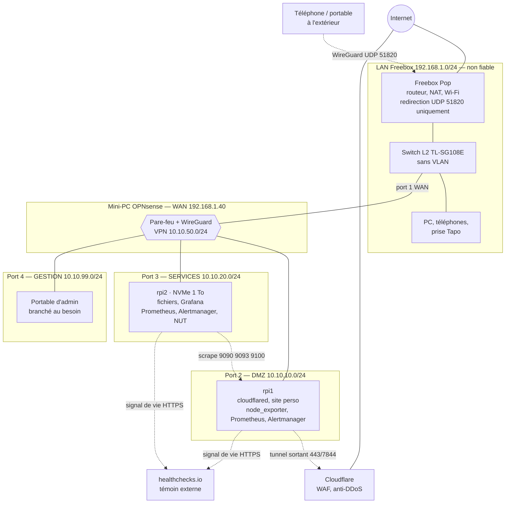

# Architecture réseau cible

## Le besoin

1. Héberger des services à la maison : un site perso public, du stockage de fichiers privé, le monitoring.
2. Que ces services soient sécurisés : segmentation, Cloudflare en frontal, VPN pour le privé.
3. Que le réseau domestique ne soit ni attaquable par ce biais, ni ralenti.

Le troisième point avait bloqué le projet : remplacer la Freebox par un routeur qui fait VLAN + WireGuard, c'est faire passer tout le trafic de la maison par lui.

## Le schéma retenu

```
Internet ── Freebox Pop ──┬── Wi-Fi / Ethernet : PC, téléphones (LAN domestique)
                          │
                          └── WAN du pare-feu OPNsense
                                 ├── DMZ      : serveur exposé (Cloudflare Tunnel sortant)
                                 ├── SERVICES : serveur interne (accès VPN uniquement)
                                 └── GESTION  : portable d'admin, branché au besoin
```

L'idée : **la Freebox reste le routeur de la maison, le pare-feu ne protège que le labo**. Le trafic domestique ne traverse jamais OPNsense, donc aucun ralentissement possible. Vu d'OPNsense, le LAN de la Freebox est un réseau non fiable au même titre qu'Internet.

Les deux accès depuis l'extérieur :

- **Public** : le serveur en DMZ ouvre lui-même une connexion sortante vers Cloudflare (Tunnel). Les visiteurs parlent à Cloudflare, jamais directement à la maison.
- **Privé** : WireGuard sur OPNsense, via une unique redirection de port UDP sur la Freebox.

### Le schéma avec le matériel réel



L'onduleur alimente la Freebox, le switch, le mini-PC et les deux Pi ; son câble USB va sur rpi2 (NUT), qui éteint proprement les machines en fin d'autonomie.

| Élément | Adresse | Remarque |
|---------|---------|----------|
| OPNsense, WAN | `192.168.1.40` | Bail fixe sur la Freebox, cible de la redirection UDP 51820 |
| DMZ | `10.10.10.0/24` | rpi1 en `10.10.10.10`, passerelle `10.10.10.1` |
| SERVICES | `10.10.20.0/24` | rpi2 en `10.10.20.10`, passerelle `10.10.20.1` |
| VPN | `10.10.50.0/24` | Un /32 par appareil WireGuard |
| GESTION | `10.10.99.0/24` | Seule zone d'où l'on administre OPNsense et les Pi |

Les zones sont des **ports physiques** du mini-PC, pas des VLAN : chaque port est un réseau à lui seul, sans switch à configurer. Le switch L2 reste côté Freebox, où tout est déjà au même niveau de confiance, et ne transporte donc aucun VLAN. S'il fallait un jour plusieurs machines dans une zone, ajouter un petit switch dédié à cette zone plutôt que mélanger des zones sur le TL-SG108E.

Les Pi n'ont plus aucune patte sur le LAN de la Freebox : **désactiver leur Wi-Fi** (`dtoverlay=disable-wifi` dans `/boot/firmware/config.txt`). Une Pi en DMZ encore connectée au Wi-Fi de la Freebox contournerait tout le pare-feu.

## Comment l'isolation fonctionne alors que la Freebox ne connaît pas les VLAN

### Il n'y a pas de VLAN à connaître

La Freebox n'a pas besoin de connaître les zones, parce qu'**elle ne les voit jamais**. OPNsense est un routeur : il a une adresse dans chaque réseau (`192.168.1.40` côté Freebox, `10.10.10.1` côté DMZ…) et il est le seul point de passage entre eux. Tout ce qui sort du labo vers Internet est traduit (NAT) avec l'adresse `192.168.1.40`. Pour la Freebox, le labo entier est **un seul appareil** de son LAN, comme une console de jeu.

C'est exactement ce que fait déjà la Freebox avec la maison : Internet ne connaît pas `192.168.1.0/24`, il ne voit que l'IP publique. On empile simplement un deuxième étage du même principe.

Les VLAN n'interviennent que si l'on veut faire passer plusieurs zones sur un même câble (un PC à une seule carte réseau vers le switch). Avec un mini-PC à 4 ports, il n'y en a pas.

### Que devient un broadcast de la DMZ ?

Un broadcast (ARP, DHCP, mDNS, découverte réseau…) ne traverse **jamais un routeur**. Il reste sur le segment de niveau 2 où il a été émis : ici, le câble entre rpi1 et le port 2 d'OPNsense. OPNsense le reçoit, répond s'il est concerné (DHCP, ARP de sa propre adresse) et ne le retransmet nulle part. La Freebox, les PC et rpi2 ne le voient pas.

Seule exception : les relais explicites (plugin « mDNS repeater », relais DHCP). Ne pas les activer entre zones.

### Une requête de la DMZ vers le PC (`192.168.1.42`)

Ce qui se passe réellement, étape par étape :

1. rpi1 (`10.10.10.10`) veut joindre `192.168.1.42`. Ce n'est pas son réseau : il ne fait **pas** d'ARP pour le PC, il envoie le paquet à sa passerelle, `10.10.10.1` (OPNsense).
2. OPNsense regarde sa table de routage. `192.168.1.0/24` est **directement connecté** sur son WAN : il n'a pas besoin de la Freebox, il fait lui-même un ARP pour `192.168.1.42` sur le LAN Freebox et livrerait le paquet directement au PC.
3. Avant de le livrer, il applique les règles de l'interface DMZ.
   - Avec une règle naïve « DMZ → any » : **le paquet passe**. Le PC le reçoit, avec comme source `192.168.1.40` après NAT. Un serveur compromis peut donc scanner et attaquer toute la maison.
   - Avec la règle « DMZ → réseaux privés : bloquer » placée avant : **le paquet est jeté**. Il n'existe aucun autre chemin, puisque OPNsense est le seul lien physique entre la DMZ et le reste.

La Freebox n'intervient jamais, avec ou sans VLAN : c'est OPNsense qui décide, et c'est pourquoi la condition n° 1 ci-dessous est critique. Le schéma de départ est sûr, mais pas par défaut.

### L'inverse : du PC vers la DMZ

1. Le PC (`192.168.1.42`) veut joindre `10.10.10.10`. Pas son réseau : il envoie à sa passerelle, la Freebox.
2. La Freebox ne connaît pas `10.10.10.0/24` (aucune route) : elle envoie le paquet vers Internet, où il est jeté car les adresses privées n'y sont pas routées.
3. Même si l'on ajoutait une route vers OPNsense, le paquet arriverait sur son WAN, où tout ce qui n'est pas une réponse à une connexion sortante est bloqué par défaut.

La maison ne peut donc pas entrer dans le labo, ni par erreur ni par malveillance. Pour utiliser les services depuis le salon, on passe par WireGuard, exactement comme depuis l'extérieur.

### Cas pratiques

| Situation | Ce qui se passe |
|-----------|-----------------|
| Le site perso sur rpi1 est piraté, l'attaquant scanne `192.168.1.0/24` | Bloqué par la règle anti-réseaux privés de la DMZ |
| Il tente de joindre rpi2 (`10.10.20.10`) | Bloqué : aucune règle DMZ → SERVICES |
| Il tente d'ouvrir l'interface web ou le SSH d'OPNsense via `10.10.10.1` | Bloqué si l'administration n'écoute que sur GESTION (à vérifier : par défaut OPNsense écoute sur toutes les interfaces, n'autoriser depuis la DMZ que DNS et NTP vers le pare-feu) |
| Il veut exfiltrer des données vers un serveur à lui | Bloqué si la sortie de la DMZ est filtrée (Cloudflare, miroirs Debian, NTP uniquement) ; sinon possible, mais rpi1 ne contient rien d'important |
| Un PC de la maison attrape un malware | Il voit `192.168.1.40` comme un hôte fermé ; aucun port n'y répond, WireGuard compris tant qu'il n'a pas de clé |
| Un invité branche son portable sur la Freebox | Même chose : il est dans la zone non fiable |
| Une Pi de la DMZ a gardé son Wi-Fi connecté à la Freebox | **Isolation détruite** : elle est directement sur le LAN de la maison, sans pare-feu |
| Quelqu'un branche un câble entre le switch de la maison et le port DMZ | Isolation détruite aussi. La sécurité d'une segmentation physique, c'est le câblage : étiqueter les ports |
| OPNsense lui-même est compromis | Tout tombe : c'est la pièce maîtresse. D'où : mises à jour, administration seulement depuis GESTION, aucun service exposé sur le WAN à part WireGuard |

La DMZ est donc isolée **si** trois choses sont vraies : le seul lien physique est le port d'OPNsense, les règles bloquent les réseaux privés, et OPNsense n'expose pas son administration à la DMZ. Ce n'est pas parfait au sens absolu (une faille d'OPNsense ou de WireGuard reste possible), mais c'est le niveau des réseaux d'entreprise.

### « Isolée » veut dire quoi, exactement ?

Une DMZ n'est pas une zone sans aucun flux : elle sert justement à héberger ce qui est joignable depuis l'extérieur. La règle classique est **asymétrique** :

- **La DMZ n'initie rien vers l'intérieur.** Aucune connexion partant de rpi1 vers SERVICES, GESTION ou le LAN Freebox. C'est ce qui compte : un serveur compromis ne peut pas rebondir.
- **L'intérieur peut initier vers la DMZ.** L'administration depuis GESTION, la collecte de métriques depuis rpi2. Le pare-feu étant à états, rpi1 peut *répondre* à ces connexions, mais ne peut pas en ouvrir.
- **La DMZ sort vers Internet de façon limitée** : Cloudflare, mises à jour, témoin de monitoring.

Le seul risque résiduel du sens intérieur → DMZ est qu'un rpi1 compromis renvoie des réponses piégées au Prometheus de rpi2. Ce risque est faible, mais il existe une variante **stricte** si l'on veut zéro échange avec l'intérieur hors administration : rpi1 se surveille lui-même (son propre Prometheus et Alertmanager, alertes directes sur Discord), et le témoin externe vérifie qu'il est vivant. On perd seulement ses courbes dans le Grafana de rpi2.

## Alternative : un seul routeur pour toute la maison

Le schéma retenu est un compromis assumé, pas la cible idéale. L'architecture la plus complète met le mini-PC OPNsense en routeur principal : la Freebox passe en mode bridge (elle ne fait plus que modem) et OPNsense gère **toute** la maison.

| | Labo derrière la Freebox (schéma retenu) | OPNsense routeur principal |
|---|---|---|
| Segmentation | Le labo seulement | Tout : labo, PC, objets connectés, invités, chacun dans son VLAN |
| QoS | Débit du labo seulement | Toute la maison, y compris anti-*bufferbloat* (latence stable en visio ou en jeu pendant un gros transfert) |
| NAT | Double (Freebox puis OPNsense) | Simple, IPv6 plus propre |
| Si OPNsense tombe ou est mal configuré | Seul le labo est coupé | **Plus d'Internet dans la maison** |
| Wi-Fi | Celui de la Freebox | Points d'accès à acheter, capables de gérer les VLAN |
| Services Freebox (TV, téléphone) | Inchangés | À vérifier en mode bridge |
| Complexité | Faible, la maison n'est pas touchée | Plus élevée, la maison dépend du labo |

Avec un mini-PC x86 correct, le ralentissement n'est plus un argument : il route et filtre plus vite que la fibre, WireGuard compris. La vraie question est la dépendance : faut-il que l'Internet de la famille dépende de son labo ?

**Les deux ne s'opposent pas** : c'est le même mini-PC et les mêmes règles. On commence par le labo derrière la Freebox, sans risque pour la maison. Une fois OPNsense maîtrisé et stable, on peut le promouvoir en routeur principal, ajouter les VLAN maison et un point d'accès Wi-Fi. Rien de ce qui a été fait n'est perdu.

### WireGuard et le débit de la maison

WireGuard tourne sur OPNsense, qui n'est pas « exposé » au sens d'un serveur : sur le WAN, le seul port joignable est UDP 51820, muet sans clé.

- **Sans connexion VPN** : aucun effet. Le trafic de la maison va directement à la Freebox et ne touche pas OPNsense.
- **Avec une connexion VPN** : seul le trafic de l'appareil connecté passe par OPNsense. En *split tunnel* (dans le client, `AllowedIPs` limité aux réseaux du labo), même cet appareil continue d'aller sur Internet directement. Un mini-PC N100 chiffre plusieurs centaines de Mb/s en WireGuard, plus que l'upload utile en pratique.
- **Ce qui est partagé**, c'est la fibre : un gros transfert via le VPN ou depuis le site consomme du débit montant. C'est le rôle du *traffic shaper* d'OPNsense (section Qualité de service).

### Comment WireGuard traverse les deux routeurs

**Le principe.** Chaque appareil a une paire de clés. Le serveur (OPNsense) connaît la clé publique de chaque client et l'adresse VPN qui lui est attribuée ; chaque client connaît la clé publique du serveur et son adresse (`Endpoint`). Il n'y a ni login ni mot de passe : un paquet n'est accepté que s'il est chiffré par une clé connue. Tout passe en **UDP** : un paquet chiffré qui contient un paquet IP ordinaire.

**Exemple : le téléphone en 4G ouvre le cloud sur rpi2.**

Aller :

1. L'appli veut joindre `10.10.20.10:443`. Le système voit que `10.10.20.0/24` est dans les `AllowedIPs` du tunnel : le paquet part dans l'interface WireGuard au lieu d'aller directement sur Internet.
2. WireGuard le chiffre et l'emballe dans un datagramme UDP : source = IP 4G du téléphone, destination = **IP publique de la Freebox, port 51820**.
3. **Freebox** : une redirection de port dit « UDP 51820 → `192.168.1.40` ». Elle remplace la destination (DNAT) et livre le datagramme au WAN d'OPNsense. Elle ne voit qu'un paquet UDP illisible.
4. **OPNsense, WAN** : la règle « UDP 51820 vers ce pare-feu » laisse entrer le datagramme. WireGuard vérifie qu'il vient d'une clé connue, le déchiffre, et en sort le paquet d'origine (`10.10.50.2` → `10.10.20.10:443`), qui apparaît sur l'interface WireGuard.
5. **OPNsense, interface WireGuard** : nouvelle vérification, avec les règles propres au VPN (ce pair a-t-il droit au port 443 de rpi2 ?), puis routage vers le port SERVICES, comme n'importe quel paquet entre zones.

Retour : rpi2 répond à `10.10.50.2` via sa passerelle (OPNsense). OPNsense sait que cette adresse appartient au pair « téléphone », chiffre la réponse et l'envoie en UDP depuis `192.168.1.40:51820` vers la dernière adresse connue du téléphone. La Freebox se souvient de la traduction faite à l'aller et remet la bonne IP publique en source.

Les deux routeurs ne font donc que transporter des datagrammes UDP opaques. Seul OPNsense, qui détient la clé, voit le contenu, et il le filtre comme s'il venait d'une zone de plus.

**Pourquoi le port est « muet ».** Le premier paquet d'un client doit prouver qu'il connaît la clé publique du serveur, et le serveur ne répond que si la clé du client est dans sa liste. Un scanner n'obtient aucune réponse : le port est indiscernable d'un port fermé.

**Ce qu'il faut régler en pratique :**

- **IPv4 « full-stack » chez Free.** Selon l'offre, l'IPv4 peut être partagée entre plusieurs abonnés, avec seulement une plage de ports redirigeables. Vérifier dans l'espace abonné et demander une IPv4 full-stack (option gratuite) pour pouvoir rediriger le port 51820.
- **Adresse stable** : l'IPv4 Free est en général fixe ; sinon un nom DynDNS dans l'`Endpoint` des clients.
- **Changement de réseau** : si le téléphone passe du Wi-Fi à la 4G, WireGuard continue avec la nouvelle adresse dès le paquet suivant, sans reconnexion.
- **`PersistentKeepalive = 25`** côté client : un petit paquet toutes les 25 s garde ouverte la traduction d'adresse de l'opérateur mobile, pour que le serveur puisse toujours répondre.
- **Depuis la maison** : le téléphone sur le Wi-Fi de la Freebox vise la même IP publique, et la Freebox doit alors renvoyer le paquet vers son propre LAN. Si ça ne marche pas, utiliser un nom DNS qui résout vers `192.168.1.40` à la maison, et décocher « Block private networks » sur le WAN d'OPNsense, puisque ces clients ont une adresse privée.

## Est-ce sécurisé ?

Oui, c'est une bonne architecture, **à condition d'ajouter une règle que le schéma ne montre pas** (point 1 ci-dessous). Sans elle, la promesse « réseau domestique inattaquable » n'est pas tenue.

### Ce qui est solide, et pourquoi

**Aucun port entrant pour le web.** Avec un Tunnel, c'est le serveur qui appelle Cloudflare. Il n'y a pas de redirection de port vers la DMZ : un scan de l'IP publique ne trouve rien, et l'IP de la maison n'apparaît pas dans le DNS. Le WAF, l'anti-DDoS et Cloudflare Access filtrent avant que la moindre requête n'arrive chez soi.

**Le seul port ouvert est muet.** WireGuard ne répond pas aux paquets qui ne sont pas signés par une clé connue. Pour un scanner, le port est indiscernable d'un port fermé. Pas de bannière, pas de page de login, pas de mot de passe à forcer : la surface d'attaque se résume à la bibliothèque cryptographique de WireGuard, petite et auditée. C'est bien plus étroit qu'un sshd exposé, même durci.

**Une compromission reste confinée.** Le service le plus exposé (le site public) est sur une machine dont tout le trafic passe par le pare-feu. Si elle tombe, l'attaquant ne peut joindre ni le serveur interne, ni la gestion.

**Le labo est protégé de la maison.** Un PC ou un objet connecté compromis sur le LAN domestique voit OPNsense comme le voit Internet : un WAN fermé. Pour atteindre les services il faut passer par le VPN, même depuis le salon.

**La gestion est hors bande.** L'interface d'OPNsense et le SSH des serveurs ne sont joignables que depuis un port physique dédié. Aucune erreur de règle côté DMZ ne peut exposer l'administration.

### Les conditions à respecter

**1. Interdire à la DMZ (et à SERVICES) de joindre le LAN de la Freebox. C'est le point critique.**

Pour aller sur Internet, un paquet de la DMZ sort par le WAN d'OPNsense, c'est-à-dire *à travers le LAN domestique*. Une règle habituelle « DMZ → any » autorise donc aussi DMZ → `192.168.1.0/24` : un serveur compromis pourrait attaquer les PC, les téléphones et l'interface de la Freebox. Le pare-feu protège le labo de la maison, mais pas l'inverse, sauf si on l'écrit :

- sur DMZ et SERVICES : **bloquer** toute destination RFC 1918 (`10.0.0.0/8`, `172.16.0.0/12`, `192.168.0.0/16`), placé avant la règle d'accès à Internet ;
- DNS servi par OPNsense (Unbound), pas par la Freebox : autoriser le port 53 vers l'adresse du pare-feu dans la zone **avant** la règle de blocage, puisque cette adresse est elle aussi privée.

Le routage vers Internet continue de fonctionner : les paquets destinés à Internet ont une adresse de destination publique, que la règle ne touche pas. OPNsense les remet à la Freebox, sa passerelle par défaut ; les serveurs, eux, n'ont jamais besoin d'adresser un paquet à la Freebox. Détail pas à pas dans [Une requête de la DMZ vers le PC](#une-requête-de-la-dmz-vers-le-pc-192168142).

**2. Tout fermer par défaut entre les zones.** Matrice de flux visée :

| De ↓ vers → | Internet | LAN Freebox | DMZ | SERVICES | GESTION |
|-------------|----------|-------------|-----|----------|---------|
| **DMZ** | Cloudflare (443, 7844), mises à jour, DNS, NTP, témoin de monitoring | ✗ | – | ✗ | ✗ |
| **SERVICES** | mises à jour, sauvegarde distante, Discord | ✗ | monitoring (9090, 9093, 9100) | – | ✗ |
| **GESTION** | ✓ | ✗ | SSH, interfaces web | SSH, interfaces web | – |
| **VPN** | au choix | ✗ | selon besoin | ✓ | ✗ de préférence |
| **LAN Freebox / Internet** | – | – | ✗ | ✗ | ✗ |

Filtrer aussi la **sortie** de la DMZ (deuxième colonne) : un serveur compromis qui ne peut joindre que Cloudflare et les miroirs Debian est beaucoup moins utile à un attaquant.

**3. IPv6.** La Freebox distribue de l'IPv6, et en IPv6 il n'y a pas de NAT pour masquer une erreur. Activer le pare-feu IPv6 de la Freebox, et soit ne pas router d'IPv6 vers le labo, soit écrire les règles pour les deux familles. La règle du point 1 doit couvrir le préfixe IPv6 du LAN.

**4. Cloudflare voit le trafic en clair.** Le TLS se termine chez eux. Pour un site public c'est sans importance. Pour des fichiers personnels, c'est un tiers de plus qui peut les lire : raison de plus pour les laisser dans SERVICES, derrière le VPN, et de ne passer par le Tunnel que ce qui est destiné au public. Si une application privée doit quand même passer par Cloudflare, la protéger avec Access (authentification avant d'atteindre le serveur).

**5. Le jeton du Tunnel est un secret.** Il vit sur la machine la plus exposée. S'il fuit, quelqu'un peut servir du contenu sous le nom de domaine. Le stocker dans le vault, le révoquer en cas de doute.

**6. Ne pas utiliser la fonction « DMZ » de la Freebox**, qui redirige *tous* les ports vers une machine. Une seule redirection : le port UDP de WireGuard vers l'adresse WAN d'OPNsense (bail DHCP fixe). Supprimer l'ancienne redirection du port SSH 2002.

**7. Aucun contournement physique.** Wi-Fi des Pi désactivé, une seule prise réseau par Pi, aucun câble entre le switch de la maison et un port de zone.

**8. OPNsense ne s'administre que depuis GESTION.** Interface web et SSH du pare-feu limités à cette interface ; depuis DMZ et SERVICES, seuls DNS et NTP vers le pare-feu sont autorisés.

### Ce que le schéma ne fait pas

Il **ne segmente pas le réseau domestique lui-même**. PC, téléphones, prise Tapo et invités restent sur le même réseau à plat : la maison n'est pas moins sûre qu'avant, mais pas plus. La Freebox ne propose que le Wi-Fi invité comme isolation. C'est le prix de « zéro ralentissement ». Si un jour les objets connectés doivent être isolés, il faudra soit un point d'accès Wi-Fi gérant les VLAN derrière OPNsense, soit accepter de faire passer la maison par le pare-feu.

Sur ce dernier point, la crainte d'origine est à relativiser : un mini-PC x86 récent (Intel N100) route et filtre plusieurs Gb/s, soit plus que la fibre. WireGuard ne coûte du CPU que pour le trafic qui passe dans le VPN. Le ralentissement venait du matériel envisagé (une Raspberry Pi en routeur), pas du principe.

### Qualité de service

Le second volet de « ne pas impacter la maison », c'est le débit montant. Les serveurs étant tous derrière OPNsense, son *traffic shaper* peut plafonner leur débit sortant (par exemple 30 % de l'upload) : une sauvegarde ou un gros téléchargement depuis le site ne saturera pas la connexion de la maison. C'est plus efficace que la QoS par port du switch, qui ne voit pas ce qui se passe côté Freebox.

## Le matériel manquant

OPNsense ne tourne **que sur x86-64** : pas sur Raspberry Pi. Il faut donc une machine en plus, ce que la liste de matériel actuelle ne contient pas :

- un mini-PC à 4 ports réseau Intel (type N100), 150 à 200 € : correspond exactement au schéma (WAN + 3 ports) ;
- ou le PC inutilisé, s'il a deux cartes réseau : WAN d'un côté, trunk VLAN vers le switch de l'autre. Vérifier sa consommation, il tournera 24 h/24.

Avec un boîtier 4 ports, le switch n'est plus nécessaire pour la segmentation ; il peut servir à multiplier les ports d'une zone.

### OPNsense est-il obligatoire ?

Non. Le schéma demande **un pare-feu à états avec plusieurs zones et WireGuard**, pas OPNsense en particulier. Les options réalistes :

| Option | Coût indicatif | Pour | Contre |
|--------|----------------|------|--------|
| Mini-PC N100 4 ports + OPNsense | 150-200 € | Ports physiques séparés, cartes réseau Intel, puissance pour IDS et QoS, interface très complète | Le plus cher, x86 uniquement |
| **Troisième Raspberry Pi 5 + OpenWrt** | ~120 € (Pi 4 Go, alimentation, boîtier, 2 adaptateurs USB 3 Ethernet) | Moins cher, faible consommation, même famille que le reste | Un seul port Ethernet natif : adaptateurs USB (moins fiables) ou VLAN via le switch ; WireGuard à quelques centaines de Mb/s |
| Passerelle UniFi Cloud Gateway Ultra | ~120-150 € | Clé en main, interface soignée, VLAN, pare-feu par zones, WireGuard, QoS | Moins flexible, écosystème fermé, logique pensée pour être le routeur principal |
| Une des deux Pi existantes en routeur | 0 € | Gratuit | Le routeur et un serveur sur la même machine : un serveur compromis = pare-feu compromis. **À exclure** |

**Pi en routeur : à quoi faire attention.**

- **Une Pi dédiée**, jamais un des serveurs.
- **Préférer des ports physiques** : port natif = WAN, un adaptateur USB 3 par zone (DMZ, SERVICES). La zone GESTION peut disparaître si l'on administre uniquement par le VPN.
- **La variante « router on a stick »** (un seul câble vers le switch, une zone par VLAN) fonctionne, mais le TL-SG108E devient alors une barrière de sécurité, et il n'est pas fait pour ça (administration joignable depuis tous les VLAN, sans HTTPS). À éviter, ou isoler son administration et bien verrouiller les VLAN.
- **Le débit** suffit : seul le trafic du labo passe par la Pi, la maison n'est pas concernée.

**Routeur de l'opérateur.** La Freebox ne sait pas segmenter son LAN en VLAN (seul le Wi-Fi invité est isolé). Elle a un serveur WireGuard intégré, mais les clients y arrivent sur le LAN de la maison, la zone non fiable, et ne peuvent pas joindre le labo derrière le pare-feu. Aucune box d'opérateur ne remplace donc le pare-feu du labo.

## Répartition des deux Raspberry Pi

| Machine | Zone | Rôle |
|---------|------|------|
| rpi1 (carte SD) | DMZ | `cloudflared`, site perso. Aucune donnée importante : reconstruisible entièrement avec Ansible |
| rpi2 (NVMe 1 To) | SERVICES | Fichiers, Grafana, Prometheus principal. Les données vivent ici, donc derrière le VPN |

Une carte SD supporte mal les écritures continues (base Prometheus, logs). Sur rpi1 : rétention courte, ou un petit SSD USB.

## SSH ou VPN ?

Les deux, mais pas au même endroit. Le VPN devient la **seule porte d'entrée** depuis Internet ; SSH reste l'outil d'administration, joignable uniquement depuis GESTION (et éventuellement le VPN).

Le durcissement SSH du rôle `ssh` reste utile comme seconde barrière, mais le changement de port n'a plus d'intérêt une fois SSH retiré d'Internet. Dans Ansible, il suffira de renseigner `firewall_ssh_sources` avec le réseau de gestion.

WireGuard directement sur OPNsense est le bon choix ici puisque l'IP publique est joignable. Tailscale ou Headscale ne valent le détour que si l'on veut éviter toute redirection de port, au prix d'un tiers dans la boucle.

## Monitoring entre zones

Séparer les zones ne coupe pas le monitoring : OPNsense **route** entre les zones, il refuse simplement tout ce qu'une règle n'autorise pas. Une zone n'est pas injoignable, elle est filtrée. La question est donc seulement : quels flux ouvrir, et dans quel sens ?

La surveillance mutuelle actuelle (voir [ansible.md](ansible.md)) demande que chaque Pi joigne l'autre, donc des flux DMZ → SERVICES, ce qui est précisément ce qu'on veut interdire. Solution retenue : **rpi2 surveille rpi1, et un témoin externe surveille rpi2.**

```
rpi2 (SERVICES) ──scrape 9090/9093/9100──▶ rpi1 (DMZ)        sens sûr : confiance → exposé
rpi2 ──« je suis vivant » chaque minute (HTTPS sortant)──▶ healthchecks.io ──▶ Discord si silence
rpi1 ──« je suis vivant » chaque minute (HTTPS sortant)──▶ healthchecks.io ──▶ Discord si silence
```

- **rpi2 scrape rpi1** : la connexion part de la zone de confiance vers la zone exposée. Si rpi1 tombe ou se comporte mal, rpi2 alerte.
- **Qui surveille rpi2 ?** Un service externe de type « dead man's switch » (healthchecks.io, gratuit jusqu'à 20 contrôles). Chaque Prometheus porte une alerte `Watchdog` toujours active (`expr: vector(1)`) ; Alertmanager l'envoie chaque minute à une URL propre à la machine. Si le signal s'arrête, healthchecks.io prévient sur Discord. rpi1 n'a donc **besoin d'aucun accès à rpi2**.
- **Bonus** : cela couvre l'angle mort de la surveillance mutuelle. Si tout tombe ensemble (courant au-delà de l'onduleur, fibre, pare-feu), le témoin externe le voit, alors qu'aucune machine de la maison ne pourrait le signaler.
- **Pas de cluster Alertmanager entre zones** (il exigerait 9094 dans les deux sens). Seul rpi2 surveille rpi1, il n'y a donc plus de doublons à éliminer.
- **Grafana uniquement sur rpi2**, avec les données des deux machines puisque c'est lui qui les collecte.

Règles OPNsense correspondantes : SERVICES → DMZ `9090, 9093, 9100/tcp` depuis rpi2 vers rpi1 ; DMZ et SERVICES → Internet `443/tcp` (déjà autorisé pour les mises à jour). Aucune règle DMZ → SERVICES.

Variante si l'on tient à un regard croisé local : autoriser DMZ → rpi2 sur `9100/tcp` seulement (métriques en lecture seule), pour que rpi1 voie aussi si rpi2 répond. C'est une ouverture minime, mais le témoin externe la rend inutile.

Les rôles Ansible actuels font encore la surveillance mutuelle complète, adaptée au réseau à plat d'aujourd'hui. À faire au passage en zones : liste de cibles configurable par hôte, cluster Alertmanager désactivable, récepteur `Watchdog`.

## Sauvegardes

Aujourd'hui le rôle `backup` n'envoie qu'un rappel. Pour des données auxquelles on tient, viser la règle 3-2-1 :

- les données sur le NVMe de rpi2 ;
- une copie locale sur un autre support (disque USB) ;
- une copie **chiffrée hors site** (restic ou borg vers un stockage objet ou une Storage Box, quelques euros par mois).

Un deuxième serveur qui réplique en temps réel n'est pas une sauvegarde : une suppression ou un rançongiciel est répliqué aussi vite que le reste. C'est pourquoi GlusterFS à deux nœuds ne répondait pas au besoin (voir [stockage-cloud.md](stockage-cloud.md)).

### Mettre en place la sauvegarde hors site

**Outil : restic.** Il chiffre sur rpi2 *avant* d'envoyer (le stockage distant ne voit que des blocs illisibles), déduplique (seules les modifications partent chaque nuit) et garde un historique de versions.

**Destination**, au choix :

| Option | Coût indicatif | Remarques |
|--------|----------------|-----------|
| Hetzner Storage Box 1 To (BX11) | ~3,80 €/mois TTC | Espace disque brut en Allemagne, accès SFTP/SMB/rsync, trafic illimité, instantanés côté Hetzner |
| Backblaze B2 / stockage objet S3 | ~6 $/To/mois | Payé à l'usage ; « object lock » possible contre l'effacement |
| Une Pi + disque chez un proche | Prix du disque | Gratuit ensuite, reliée par WireGuard ; on peut héberger sa sauvegarde en retour |

**Ce qu'on sauvegarde** : le dossier de données du cloud, sa configuration, et pour Nextcloud un dump de la base fait juste avant (mode maintenance, sinon fichiers et base peuvent ne pas correspondre). La configuration d'OPNsense (export XML) aussi.

**Le déroulé, chaque nuit** (timer systemd sur rpi2) :

1. `restic backup` des dossiers ci-dessus ;
2. `restic forget --keep-daily 7 --keep-weekly 4 --keep-monthly 12 --prune` pour borner l'historique ;
3. `restic check` une fois par semaine pour vérifier l'intégrité ;
4. écrire l'heure de la dernière réussite dans un fichier lu par node_exporter (textfile collector) : une alerte Prometheus se déclenche si la dernière sauvegarde a plus de 26 h.

**Trois précautions qui font la différence** :

- **Le mot de passe du dépôt restic** va dans le vault *et* sur papier ou dans un gestionnaire de mots de passe hors de la maison. Si la maison brûle avec le poste de contrôle, une sauvegarde sans son mot de passe est perdue.
- **Protéger la sauvegarde d'un attaquant qui prendrait rpi2** : il ne doit pas pouvoir effacer l'historique distant. Selon la destination : clé en mode *append-only* (restic rest-server, Pi chez un proche), object lock (B2), ou instantanés gérés par le fournisseur (Storage Box).
- **Tester une restauration** une fois au début, puis de temps en temps : `restic restore latest --target /tmp/test` sur un dossier, et vérifier les fichiers.

Pour la copie locale (le « 2 » de 3-2-1), le même outil vers un disque USB branché sur rpi2 donne des restaurations rapides sans télécharger.

Sauvegarder aussi la configuration d'OPNsense (export XML) : c'est la seule pièce que ce dépôt ne sait pas reconstruire.

## Feuille de route

1. **Tout de suite** : créer le vault (hors git) et pousser l'historique nettoyé.
2. Déployer les rôles actuels sur les deux Pi (réseau à plat, comme aujourd'hui).
3. Acheter ou recycler la machine OPNsense. L'installer derrière la Freebox, créer les trois zones, écrire les règles de la matrice, tester que la DMZ ne joint pas `192.168.1.0/24`.
4. WireGuard sur OPNsense, redirection UDP sur la Freebox, suppression de la redirection SSH.
5. Déplacer rpi1 en DMZ et rpi2 en SERVICES, Wi-Fi désactivé ; mettre à jour l'inventaire et `firewall_trusted_sources` / `firewall_ssh_sources`. Tester depuis rpi1 que `192.168.1.42`, `192.168.1.254` et `10.10.20.10:22` sont injoignables.
6. Rôle `cloudflared` sur rpi1 + site perso ; vider `firewall_cloudflare_tcp_ports`.
7. Cloud personnel sur rpi2 (OpenCloud ou Nextcloud, voir [stockage-cloud.md](stockage-cloud.md)), un pair WireGuard par utilisateur, et vraie sauvegarde hors site (rôle `backup` avec restic). Monitoring adapté aux zones : rpi2 surveille rpi1, témoin externe pour les deux.
8. Confort : onduleur branché en USB avec NUT (arrêt propre des Pi sur coupure, métriques dans Prometheus), limitation de débit sur OPNsense, dead man's switch.
